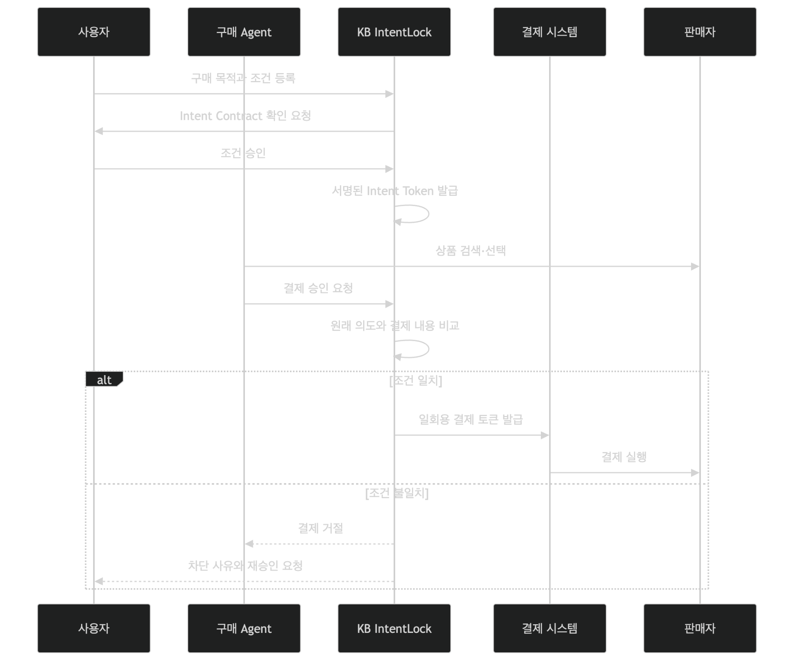
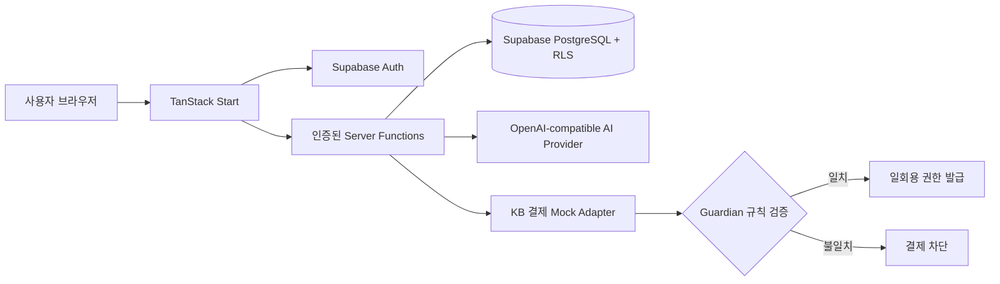

# IntentLock — Guarded Checkout

IntentLock은 AI 쇼핑 에이전트가 결제를 요청하기 전에 사용자가 승인한 구매 의도와 실제 결제 조건을 서버에서 다시 대조하는 결제 안전 샌드박스입니다. 자연어 계약을 구조화하고, 변경 감지용 SHA-256 지문을 남기며, 금액·판매자·필수 조건이 맞을 때만 제한된 일회용 결제 권한을 발급하는 흐름을 시연합니다.

> 이 저장소는 대회 시연용 프로토타입입니다. 실제 카드·계좌 정보를 수집하지 않으며 실제 결제를 수행하지 않습니다. 화면의 가상카드, 네트워크 토큰, 영수증 및 상품 후보는 모두 샌드박스 데이터입니다.



## 핵심 기능

- 자연어 구매 의도를 금액·목적·횟수·부가 조건으로 정규화
- 승인된 계약의 SHA-256 지문, 버전, 만료 시각 기록
- 결제 직전 Guardian이 계약과 주문 금액을 재검증해 `ALLOW` 또는 `BLOCK` 판정
- AI 쇼핑 후보 생성과 강제 차단 시나리오 비교
- Intent Token 검증 → 일회용 가상카드 → 네트워크 토큰 → 승인/폐기 흐름 시뮬레이션
- 0원 테스트 구매, Beta Pass, Guardian 리포트, 구매 내역 및 운영자 취소 흐름
- Supabase Auth, RLS, 서버 전용 쓰기, 멱등 키, 감사 이벤트 적용

## 아키텍처



브라우저는 인증과 조회에 publishable key만 사용합니다. 주문·계약·결제·리포트·감사 로그 변경은 인증된 서버 함수가 소유권과 역할을 확인한 뒤 service-role 클라이언트로 수행합니다. AI는 계약 정규화와 후보 생성의 보조 수단이며, 샌드박스 결제의 최종 금액·판매자·토큰 검증은 코드 규칙으로 처리합니다.

## 기술 스택

- React 19, TypeScript, TanStack Start/Router/Query
- Vite 8, Tailwind CSS 4, Radix UI
- Supabase Auth, PostgreSQL, Row Level Security
- OpenAI-compatible chat-completions API
- Nitro 기반 서버 빌드

## 로컬 실행

요구 사항은 Node.js `20.19+` 또는 `22.12+`와 npm입니다.

```bash
git clone <repository-url>
cd chic-harmony-design
npm ci
cp .env.example .env.local
npm run dev
```

앱은 기본적으로 `http://localhost:3000`에서 실행됩니다. `.env.local`에는 본인의 Supabase 프로젝트와 AI 제공자 값을 입력해야 합니다.

### 환경 변수

| 변수                            | 노출 범위     | 설명                                     |
| ------------------------------- | ------------- | ---------------------------------------- |
| `VITE_SUPABASE_URL`             | 브라우저 공개 | Supabase 프로젝트 URL                    |
| `VITE_SUPABASE_PUBLISHABLE_KEY` | 브라우저 공개 | RLS가 적용된 publishable key             |
| `SUPABASE_URL`                  | 서버          | Supabase 프로젝트 URL                    |
| `SUPABASE_PUBLISHABLE_KEY`      | 서버          | 사용자 JWT 검증용 publishable key        |
| `SUPABASE_SERVICE_ROLE_KEY`     | 서버 비밀     | 검증 완료 후 DB 변경에만 사용하는 키     |
| `AI_API_KEY`                    | 서버 비밀     | AI 제공자 인증 키                        |
| `AI_API_URL`                    | 서버          | OpenAI 호환 `/chat/completions` 전체 URL |
| `AI_MODEL`                      | 서버          | JSON 응답을 지원하는 모델명              |
| `KB_PAYMENT_MODE`               | 서버          | 현재는 `mock`만 지원                     |

`SUPABASE_SERVICE_ROLE_KEY`와 `AI_API_KEY`에는 절대 `VITE_` 접두사를 붙이지 마세요. `.env`, `.env.local` 등 실제 환경 파일은 Git에서 제외됩니다.

### Supabase 설정

1. Supabase 프로젝트에 `supabase/migrations`의 SQL을 순서대로 적용합니다.
2. Authentication에서 Google provider를 활성화합니다.
3. Redirect URL에 `http://localhost:3000/checkout`과 실제 배포 주소의 `/checkout`을 등록합니다.
4. 운영자 화면을 사용할 계정만 신뢰할 수 있는 관리자 경로에서 `user_roles`의 `operator` 역할로 지정합니다.

## 검증

```bash
npm run typecheck
npm run lint
npm run build
# 또는 전체 실행
npm run check
```

## 시연 순서

1. Google 계정으로 로그인합니다.
2. `구매`에서 0원 테스트 Beta Pass를 발급합니다.
3. `AI 에이전트`에서 구매 요청과 예산을 입력해 정상 승인 흐름을 확인합니다.
4. `거부 시나리오 강제`를 켜 같은 요청이 Guardian에서 차단되는 흐름을 비교합니다.
5. `Beta Pass`에서 별도 시나리오의 Guardian 리포트를 생성합니다.
6. `구매 내역`에서 주문·이용권·감사 결과를 확인합니다.

## 구현 범위와 한계

- KB 결제 연동은 제안 구조를 보여 주는 메모리 기반 Mock Adapter입니다. 서버가 재시작되면 가상카드와 네트워크 토큰 상태는 초기화됩니다.
- AI가 생성한 상품명·판매자·URL은 시연 데이터이며 실제 판매 페이지의 존재나 가격을 보장하지 않습니다.
- 실제 결제 도입 전에는 금융사 API 계약, 키 관리, 웹훅 검증, DB 트랜잭션, 환불 대사 및 규제 검토가 추가로 필요합니다.
- Supabase RLS는 조회 범위를 사용자 소유 데이터로 제한하고, 브라우저의 직접 변경 권한은 제출용 보안 마이그레이션에서 회수합니다.

## 주요 디렉터리

```text
src/routes/                  화면과 파일 기반 라우팅
src/lib/intentlock.*         계약·Guardian·주문 서버 로직
src/lib/kb-payment.*         결제 권한 Mock Adapter와 타입
src/integrations/supabase/   인증, RLS 클라이언트, 생성 타입
supabase/migrations/         스키마·정책·제출용 보안 강화
```
